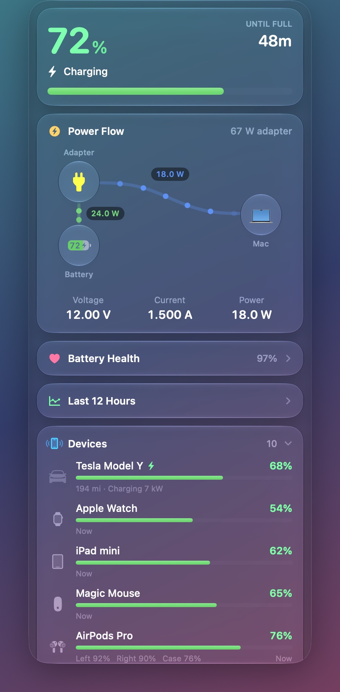
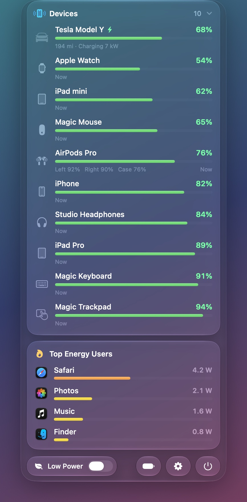
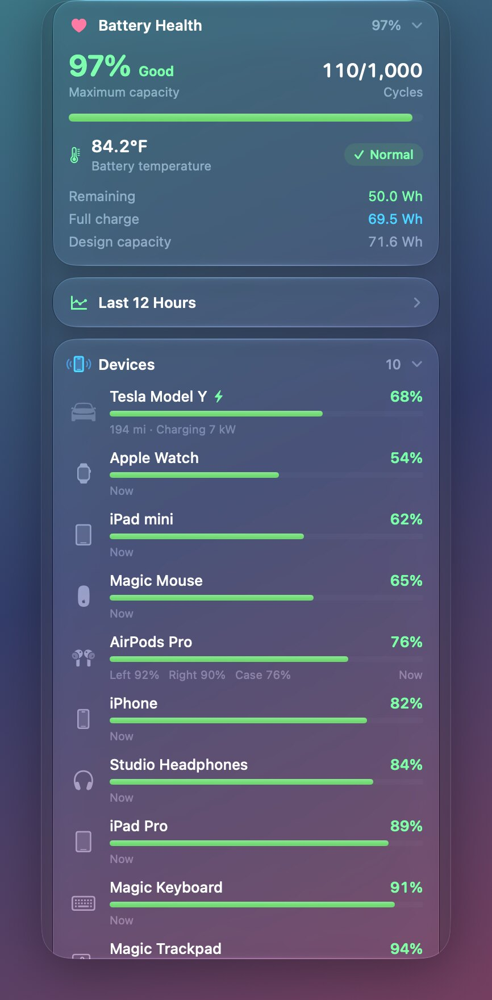
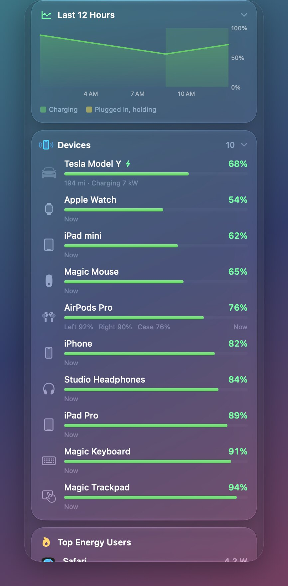
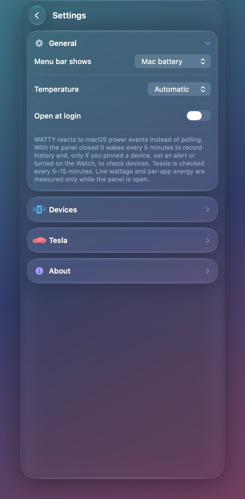
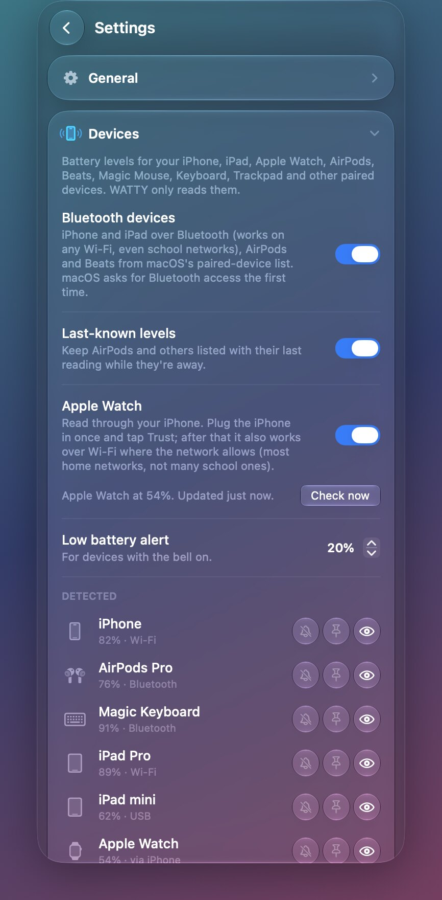
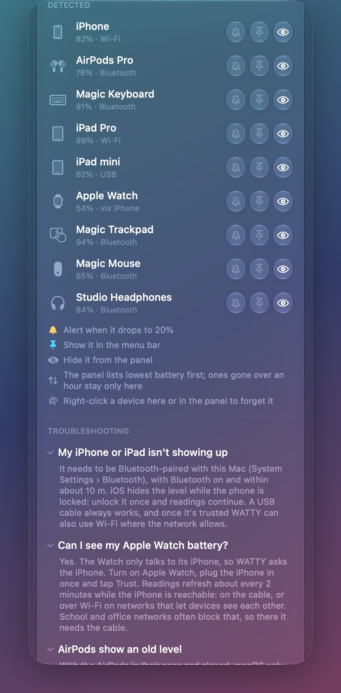
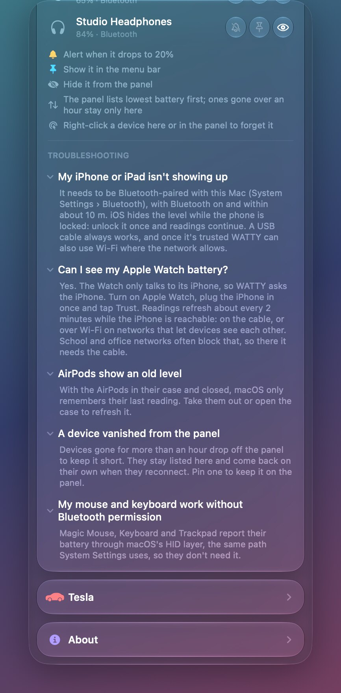
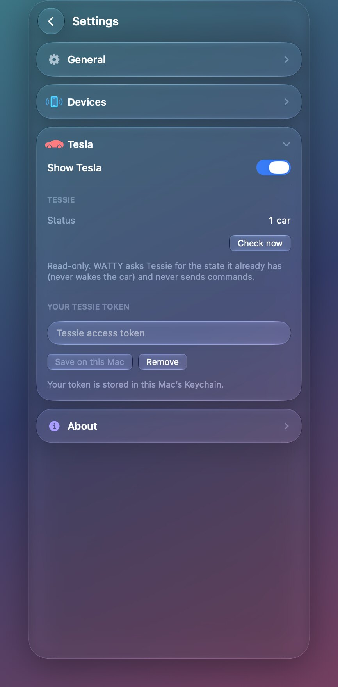
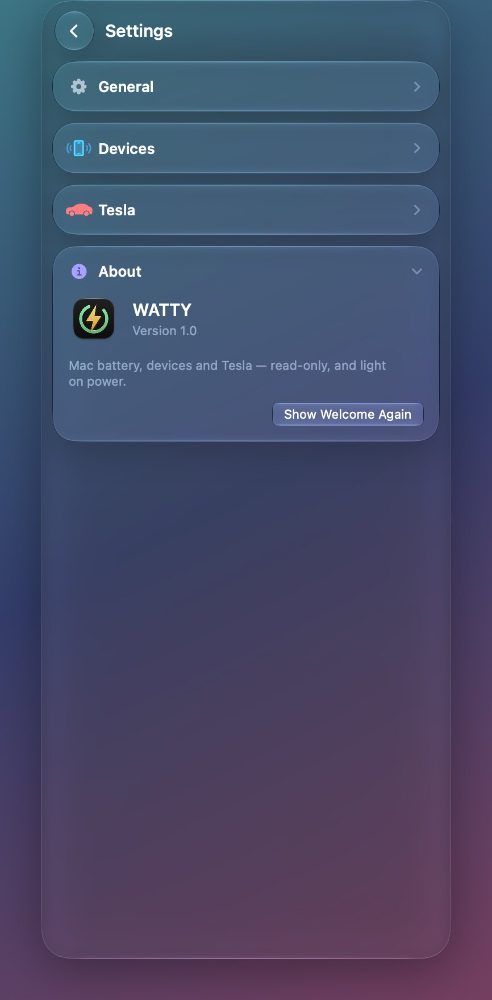

# WATTY

**[Download WATTY for Mac](https://github.com/KrinskyP03/WATTY/releases/download/v1.0-preview.1/WATTY-macOS-preview.zip)** · macOS 26 or later

I vibe-coded WATTY with Claude to see my Mac’s power draw, which apps are using energy, and how much charge my devices have left, all from the menu bar. If you drive a Tesla, add your Tessie token in Settings to see its charge too. Your Mac keeps the token in Keychain.

I built it for Apple silicon and Intel. I haven’t tested it on an Intel Mac yet.

## Screenshots

WATTY running on my Mac with sample data.

 

### Battery health and history

 

Settings and device troubleshooting

 

 

 

## Open WATTY on your Mac

1. Unzip the download, drag **WATTY** to **Applications**, and double-click it.
2. I haven’t notarized this preview yet. If macOS says it can’t verify WATTY and you trust your download, go to **System Settings → Privacy & Security**, find WATTY, and click **Open Anyway**. [Apple’s instructions](https://support.apple.com/en-us/102445)

Look for WATTY in your menu bar. If you use its Low Power Mode switch, macOS asks for an administrator password.
